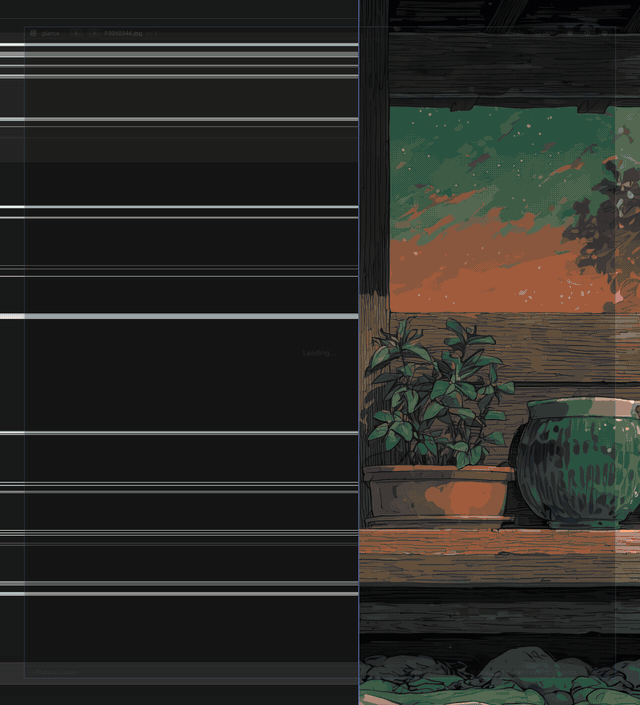

# glance

[](https://github.com/Hermantino/glance/actions/workflows/ci.yml)
[](#license)

A fast photo viewer for Linux, written in Rust: browse a folder, make quick fixes, print.

<p align="center"></p>

## Why

Sometimes I don't want to dive into GIMP, darktable, Lightroom or any other image editing software. I just want to browse a folder quickly, pick a photo, make a quick adjustment and print it. Surprisingly, I couldn't find a basic Linux app that does exactly that.

The closest candidates today:

| | Browse folder with ←/→ | Crop with print ratios | Free rotation | Exposure / brightness | Photo details (EXIF) | Printing |
|---|---|---|---|---|---|---|
| [Editt](https://github.com/mirarr-app/editt) | ✓ | ✓ | ✓ | filters | – | – |
| [Loupe](https://apps.gnome.org/Loupe/) (GNOME Image Viewer) | ✓ | crop | 90° turns | – | ✓ | generic print dialog |
| [gThumb](https://gitlab.gnome.org/GNOME/gthumb) | ✓ | ✓ | ✓ | ✓ | ✓ | generic print dialog |
| **glance** | ✓ | ✓ | ✓ | ✓ + before/after | ✓ incl. RAW | photo-paper dialog, print queue, ink levels |

<sub>Based on each project's documentation, November 2026.</sub>

- **Editt** is a fast, nice viewer and editor, but it has no printing and doesn't open RAW files.
- **Loupe** is a great viewer, but its editing stops at crop, rotate and flip.
- **gThumb** has most of the tools, but it's a full photo organiser (catalogs, tags, slideshows), so it's heavier than "open, adjust, print". Its printing goes through a general-purpose dialog.

glance does only those three things. It browses a folder instantly, gives you a few quick fixes, and has a print dialog designed around photo paper: printer, feeder, paper type, ink levels, fill or fit, and a true-to-size preview. It never stretches the photo. Mark photos as you browse and print the whole batch in one go.

## Features

- **Browse**: open a photo, a folder, or nothing (the current folder); ←/→ go through every photo in the folder. Neighbouring photos are preloaded, so stepping through is instant. Wheel zoom, drag to pan, double-click for 1:1, fullscreen.
- **Edit**: crop with ratio presets (2:3 for 10×15 cm / 4×6″, 5:7, 4:5, A4, square…), free rotation in 0.1° steps (slider, or drag a knob next to a corner) plus 90° turns, rule-of-thirds guides, exposure and gamma. Hold B to compare with the original. Edits are non-destructive until saved; saving makes a copy by default (overwrite, or overwrite with a backup, in Preferences).
- **Print**: any CUPS printer or saved preset; paper size, feeder, paper type, ink levels, fill or fit, orientation, margins, copies, and a live preview with print size and dpi. The page is composed at the exact paper size and sent as a PDF with no CUPS scaling, so photos are never stretched. Remembers the options last used with each printer.
- **Print queue**: mark photos with Space while browsing (say, a freshly filled SD card), then print them all at once, one per sheet. Edits are kept per photo.
- **Details**: a side panel with file size, dimensions, camera, lens, focal length, aperture, shutter speed, ISO, date taken and location, read from EXIF (RAW files included).
- **RAW**: shows the camera's embedded JPEG preview, and "Develop RAW…" opens the file in an installed RAW developer (darktable, RapidRAW, RawTherapee, ART…). glance does not develop RAW files itself.

| Browse | Edit | Print |
|---|---|---|
|  |  |  |

## Keyboard shortcuts

| Key | Action |
|---|---|
| ← / → (or ↑ / ↓, Page Up / Page Down) | Previous / next photo |
| Home / End | First / last photo |
| Space | Add the photo to the print queue, or remove it |
| E | Edit |
| P | Print this photo |
| Shift+P | Print the queue |
| I | Photo details |
| F or F11 | Fullscreen |
| 0 | Fit to window |
| Q | Quit |
| **In Edit** | |
| B (hold) | Show the original |
| Enter / Esc | Done / cancel |
| Shift while dragging a rotation knob | Fine rotation |

## Requirements

- Linux with a GPU that supports Vulkan or OpenGL (the UI is drawn with [egui](https://github.com/emilk/egui) and wgpu); Wayland or X11.
- [CUPS](https://openprinting.github.io/cups/) for printing: `lp`, `lpstat`, `lpoptions`, and `ipptool` for ink levels.
- Optional: [`exiftool`](https://exiftool.org/), to keep the camera metadata when saving edited photos.

## Install

### Download (any Linux distribution)

Get `glance-<version>-x86_64-linux.tar.gz` from the [latest release](https://github.com/Hermantino/glance/releases/latest), then:

```sh
tar xzf glance-*-x86_64-linux.tar.gz
./glance-*-x86_64-linux/install.sh
```

This installs glance for your user (`~/.local/bin`, plus the launcher entry and icon).

### Arch Linux

A `PKGBUILD` is included (package name `glance-viewer`, since `glance` is already taken on the AUR). It builds the latest release and installs the app, launcher entry and icon:

```sh
git clone https://github.com/Hermantino/glance.git
cd glance/packaging/aur
makepkg -si
```

### From source

Build with a recent stable [Rust toolchain](https://rustup.rs/):

```sh
git clone https://github.com/Hermantino/glance.git
cd glance
cargo build --release
install -Dm755 target/release/glance ~/.local/bin/glance
install -Dm644 glance.desktop ~/.local/share/applications/glance.desktop
install -Dm644 assets/glance.svg ~/.local/share/icons/hicolor/scalable/apps/glance.svg
```

Then open a photo with `glance photo.jpg`, a folder with `glance ~/Pictures`, or pick glance from your file manager's "Open with" menu.

To make glance your default image viewer:

```sh
xdg-mime default glance.desktop image/jpeg image/png image/tiff image/webp image/gif image/bmp
```

Preferences are stored in `~/.config/glance/config.toml`.

## Development

```sh
cargo fmt --check
cargo clippy --all-targets -- -D warnings
cargo test
```

To re-record the README demo, build with `cargo build --release --features demo`: glance then plays a short scripted tour of its features and closes.

A few tests need real photos (JPEG and RAW). Point them at a folder with `GLANCE_TEST_PHOTOS=/path/to/photos cargo test`; without it, those tests are skipped.

Bug reports and pull requests are welcome. For larger changes, please open an issue first. glance aims to stay small and fast.

What's planned, and how to vote for it, is in the [Roadmap & ideas](https://github.com/Hermantino/glance/discussions/9) discussion. Small tasks for newcomers are labelled [good first issue](https://github.com/Hermantino/glance/labels/good%20first%20issue).

## License

Licensed under either of

- Apache License, Version 2.0 ([LICENSE-APACHE](LICENSE-APACHE) or <http://www.apache.org/licenses/LICENSE-2.0>)
- MIT license ([LICENSE-MIT](LICENSE-MIT) or <http://opensource.org/licenses/MIT>)

at your option.

Unless you explicitly state otherwise, any contribution intentionally submitted for inclusion in the work by you, as defined in the Apache-2.0 license, shall be dual licensed as above, without any additional terms or conditions.

## Acknowledgements

- [egui / eframe](https://github.com/emilk/egui) for the UI, [image](https://github.com/image-rs/image) for decoding, [kamadak-exif](https://github.com/kamadak/exif-rs) for EXIF.
- Icons from [Phosphor Icons](https://phosphoricons.com/) (MIT, see [assets/Phosphor-LICENSE-MIT.txt](assets/Phosphor-LICENSE-MIT.txt)).
- Screenshot photo: Ogawara, Japan, by the author.
