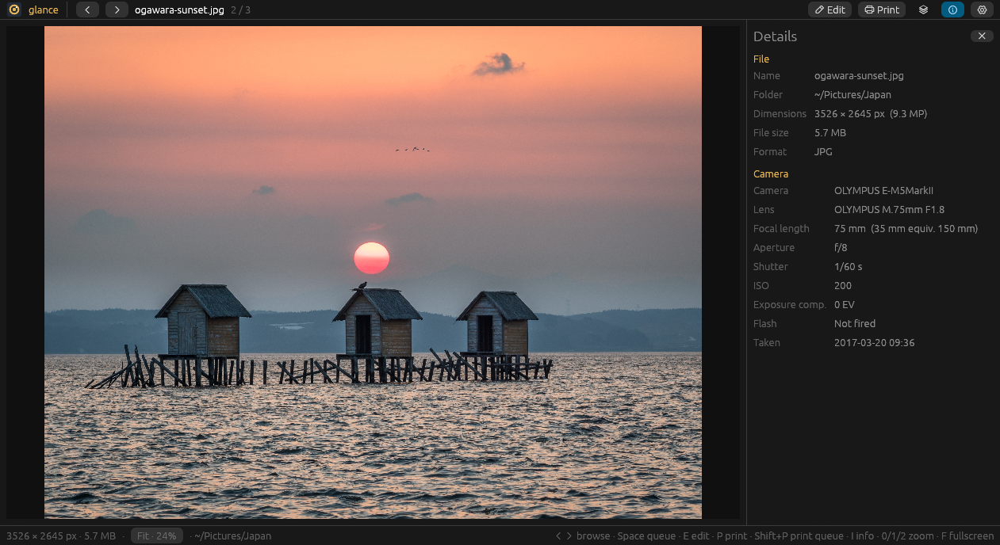
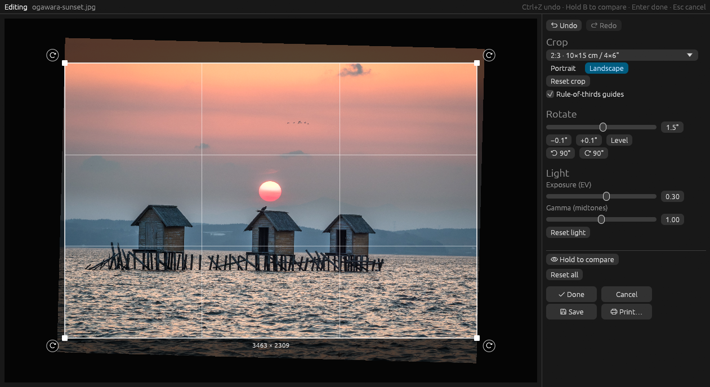
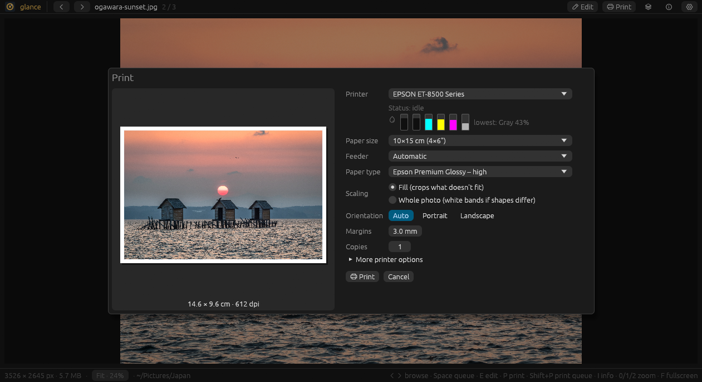

# glance

[](https://github.com/Hermantino/glance/actions/workflows/ci.yml)
[](#license)

A fast photo viewer for Linux, written in Rust: browse a folder, make quick fixes, print.

<p align="center"></p>

## Why

I'm a hobbyist photographer. For years I developed my Olympus E-M5 Mark II RAW files in Lightroom, RapidRAW or darktable and exported the final JPEGs into folders. When my daughter was born I got a Fujifilm X100VI, for the shortest path from taking a picture to sharing it with the family. And because I love analog photography, I soon wanted real prints and albums, so I bought an Epson ET-8500.

On Windows and macOS my routine was simple: browse with the system image viewer, open the ones I liked in Photoshop for a quick exposure tweak or crop, then print. On Linux I wanted one simple tool that does exactly that job well: fast browsing, quick last-minute edits, and printing. No albums, no filters, just that workflow.

None of the apps I tried clicked for me, so I made glance. Now I can sit with my daughter for five minutes, open a random folder, browse, mark the photos she likes, and print the whole batch at the end: for her to hang in her room, or for me to put in an album.

The apps I tried:

| | Browse folder with ←/→ | Crop to a ratio | Free rotation | Exposure / brightness | Photo details (EXIF) | Printing |
|---|---|---|---|---|---|---|
| [Editt](https://github.com/mirarr-app/editt) | ✓ | ✓ | ✓ | ✓ (filters and tuning) | – | – |
| [Loupe](https://apps.gnome.org/Loupe/) (GNOME Image Viewer) | ✓ | ✓ | 90° turns | – | ✓ | system print dialog |
| [gThumb](https://gitlab.gnome.org/GNOME/gthumb) | ✓ | ✓ | ✓ | ✓ | ✓ | system print dialog with a layout tab (several photos per page) |
| **glance** | ✓ | ✓ with paper sizes named | ✓ | ✓ + before/after | ✓ incl. RAW | photo-paper dialog, print queue, ink levels; one photo per sheet |

<sub>Based on each project's documentation, November 2026. If I got something wrong about an app you know, please tell me and I'll fix it.</sub>

- **Editt** is a fast, nice viewer and editor, but it has no printing and doesn't open RAW files.
- **Loupe** is a great viewer, but its editing stops at crop, rotate and flip.
- **gThumb** has most of the tools and can even put several photos on a page, which glance can't yet. It's a full photo organiser (catalogs, tags, slideshows), so it's more than I need for "open, adjust, print".

glance does only that: browse, fix, print. It browses a folder instantly, gives you a few quick fixes, and has a print dialog designed around photo paper: printer, feeder, paper type, ink levels, fill or fit, and a true-to-size preview. It never stretches the photo. Mark photos as you browse and print the whole batch in one go.

glance isn't meant to become yet another image editor or photo library manager. Feedback and ideas are very welcome with that in mind.

> **How it was made:** I designed glance and use it every day, but its code was written with AI assistance (Claude Code). I test each release on my own photos and printer before tagging it. If something breaks for you, an issue with your printer model or camera helps a lot.

## Features

- **Browse**: open a photo, a folder, or nothing (the current folder); ←/→ go through every photo in the folder. Neighbouring photos are preloaded, so stepping through is instant. Wheel zoom, drag to pan, double-click for 1:1, fullscreen. Zooming in loads the full-resolution photo on demand, so you can check focus at true 100%; the status bar shows the zoom level and whether you're seeing full resolution, and clicking it offers Fit, 50%, 100% and 200%. Edited photos are shown at full resolution too, with the edits applied.
- **Formats**: JPEG, PNG, TIFF, WebP, GIF, BMP, HEIC/HEIF/AVIF (including Fujifilm `.HIF`, via the system's libheif), and RAW files through their embedded preview.
- **Edit**: crop with ratio presets (2:3 for 10×15 cm / 4×6″, 5:7, 4:5, A4, square…), free rotation up to ±45° in 0.1° steps (slider, or drag a knob next to a corner) plus 90° turns, rule-of-thirds guides, exposure and gamma. Undo and redo with Ctrl+Z / Ctrl+Shift+Z. Hold B to compare with the original. Edits are non-destructive until saved; saving makes a copy by default (overwrite, or overwrite with a backup, in Preferences).
- **Print**: any CUPS printer or saved preset; paper size, feeder, paper type, ink levels, fill or fit, orientation, margins, copies, and a live preview with print size and dpi. The page is composed at the exact paper size and sent as a PDF with no CUPS scaling, so photos are never stretched. Remembers the options last used with each printer.
- **Print queue**: mark photos with Space while browsing (say, a freshly filled SD card), then print them all in one go, one per sheet. Edits are kept per photo.
- **Details**: a side panel with file size, dimensions, camera, lens, focal length, aperture, shutter speed, ISO, date taken and location, read from EXIF (including RAW files from most cameras).
- **Omarchy**: on [Omarchy](https://omarchy.org), glance follows your theme live (accent, background, corner style), like Omarchy's own apps. On other desktops it keeps its own amber look.
- **RAW**: shows the camera's embedded JPEG preview, and "Develop RAW…" opens the file in an installed RAW developer (darktable, RapidRAW, RawTherapee, ART…). glance does not develop RAW files itself.

## Known limitations

- **No colour management.** Photos are shown and printed as sRGB, so Adobe RGB or Display P3 photos look a little flat in glance. Saving keeps the photo's colour profile.
- **RAW files show the camera's embedded preview**, not a developed image. Some cameras embed a small one.
- **One photo per sheet** for now ([#1](https://github.com/Hermantino/glance/issues/1)).
- **Printing is tested on one printer**, an Epson ET-8500. Other printers should work through CUPS, but paper sizes and types may show raw driver names, and glance tells you when it doesn't recognise a paper size. Reports are very welcome ([#5](https://github.com/Hermantino/glance/issues/5)).
- **Editing works in 8 bits per channel.** A 16-bit TIFF or PNG is saved as 8-bit.
- **Edits last until you quit** unless you save them.
- **"Overwrite, keep the original"** tells photos apart by when they were taken. If a different file with the same name and no capture date (a screenshot, a scan) replaces one that was already backed up, its original isn't backed up again. The default, saving a copy, never touches originals.
- The ready-made download is for x86_64 only.

## Screenshots

| Browse | Edit | Print |
|---|---|---|
|  |  |  |

## Keyboard shortcuts

| Key | Action |
|---|---|
| ← / → (or ↑ / ↓, Page Up / Page Down, Backspace for previous) | Previous / next photo |
| Home / End | First / last photo |
| Space | Add the photo to the print queue, or remove it |
| E | Edit |
| P or Ctrl+P | Print this photo |
| Shift+P | Print the queue |
| I | Photo details |
| F or F11 | Fullscreen (Esc leaves it) |
| 0 / 1 / 2 | Zoom: fit / 100% (actual pixels) / 200% (also from the zoom readout in the status bar) |
| Q | Quit |
| **In Edit** | |
| Ctrl+Z / Ctrl+Shift+Z (or Ctrl+Y) | Undo / redo |
| B (hold) | Show the original |
| Enter / Esc | Done / cancel |
| Shift while dragging a rotation knob | Fine rotation |

## Requirements

- Linux with a GPU that supports Vulkan or OpenGL (the UI is drawn with [egui](https://github.com/emilk/egui) and wgpu); Wayland or X11.
- [CUPS](https://openprinting.github.io/cups/) for printing: `lp`, `lpstat`, `lpoptions`, and `ipptool` for ink levels. On Debian and Ubuntu these come from `cups-client` and `cups-ipp-utils`.
- Optional: [libheif](https://github.com/strukturag/libheif), to open HEIC/HEIF/AVIF photos (loaded at runtime if installed; on Arch: `libheif`).
- Optional: [`exiftool`](https://exiftool.org/), to keep the camera metadata when saving edited photos. Without it, saved photos lose their camera information (date, camera, GPS); glance tells you when that happens.

## Install

### Download (x86_64, glibc 2.35 or newer: Ubuntu 22.04, Debian 12, Fedora 36 and later)

Get `glance-<version>-x86_64-linux.tar.gz` from the [latest release](https://github.com/Hermantino/glance/releases/latest), then:

```sh
tar xzf glance-*-x86_64-linux.tar.gz
./glance-*-x86_64-linux/install.sh
```

This installs glance for your user (`~/.local/bin`, plus the launcher entry and icon). Make sure `~/.local/bin` is on your `PATH`.

### Arch Linux

A `PKGBUILD` is included (package name `glance-viewer`, since `glance` is already taken on the AUR). It builds the latest release and installs the app, launcher entry and icon:

```sh
git clone https://github.com/Hermantino/glance.git
cd glance/packaging/aur
makepkg -si
```

### From source

Build with Rust 1.95 or newer (install it with [rustup](https://rustup.rs/); distribution packages are often older):

```sh
git clone https://github.com/Hermantino/glance.git
cd glance
cargo build --release
install -Dm755 target/release/glance ~/.local/bin/glance
install -Dm644 glance.desktop ~/.local/share/applications/glance.desktop
install -Dm644 assets/glance.svg ~/.local/share/icons/hicolor/scalable/apps/glance.svg
```

Then open a photo with `glance photo.jpg`, a folder with `glance ~/Pictures`, or pick glance from your file manager's "Open with" menu.

To make glance your default image viewer:

```sh
xdg-mime default glance.desktop image/jpeg image/png image/tiff image/webp image/gif image/bmp image/heic image/heif image/avif
```

Preferences are stored in `~/.config/glance/config.toml`.

## Development

```sh
cargo fmt --check
cargo clippy --all-targets -- -D warnings
cargo test
```

To re-record the README demo, build with `cargo build --release --features demo`: glance then plays a short scripted tour of its features and closes. For screenshots, `GLANCE_DEMO=show:edit` (or `info`, `print`, `prefs`, `queue`) opens that screen and stays there.

A few tests can also run on real photos (JPEG and RAW): point them at a folder with `GLANCE_TEST_PHOTOS=/path/to/photos cargo test`. Without it they use generated images or are skipped.

Bug reports and pull requests are welcome. For larger changes, please open an issue first. glance aims to stay small and fast.

What's planned, and how to vote for it, is in the [Roadmap & ideas](https://github.com/Hermantino/glance/discussions/9) discussion. Small tasks for newcomers are labelled [good first issue](https://github.com/Hermantino/glance/labels/good%20first%20issue).

## License

Licensed under either of

- Apache License, Version 2.0 ([LICENSE-APACHE](LICENSE-APACHE) or <http://www.apache.org/licenses/LICENSE-2.0>)
- MIT license ([LICENSE-MIT](LICENSE-MIT) or <http://opensource.org/licenses/MIT>)

at your option.

Unless you explicitly state otherwise, any contribution intentionally submitted for inclusion in the work by you, as defined in the Apache-2.0 license, shall be dual licensed as above, without any additional terms or conditions.

## Acknowledgements

- [egui / eframe](https://github.com/emilk/egui) for the UI, [image](https://github.com/image-rs/image) for decoding, [kamadak-exif](https://github.com/kamadak/exif-rs) for EXIF.
- Fonts bundled by egui: Ubuntu (Ubuntu Font Licence), Hack (MIT and Bitstream Vera licence), Noto Emoji (OFL), emoji-icon-font (MIT).
- Icons from [Phosphor Icons](https://phosphoricons.com/) (MIT, see [assets/Phosphor-LICENSE-MIT.txt](assets/Phosphor-LICENSE-MIT.txt)).
- Screenshot photo: Ogawara, Japan, by the author.
